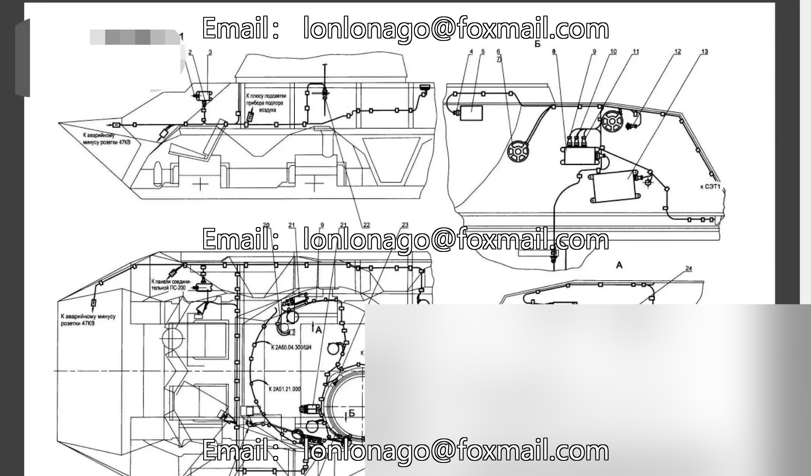
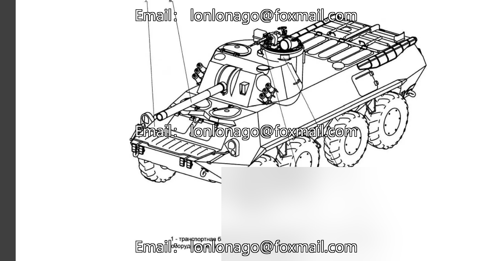
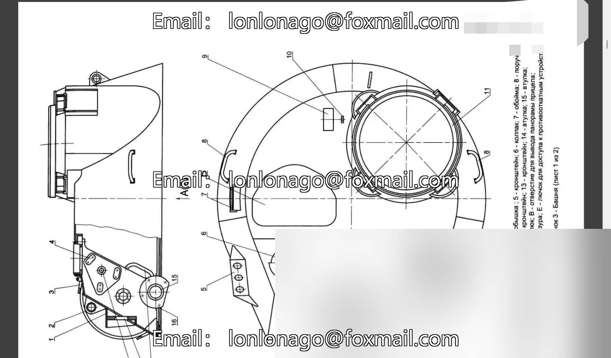
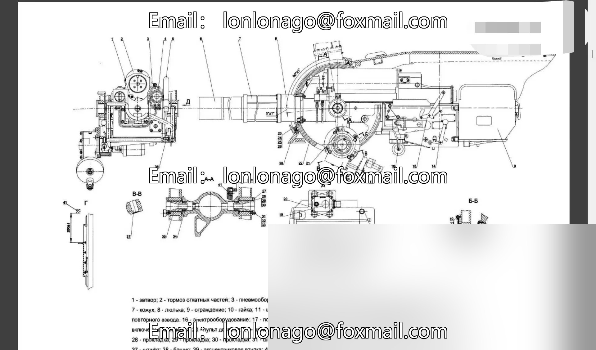

# 2C23 self-propelled cannon drawing set, 60-page

## Body

2C23 Self-propelled fire cannon drawing set, 60-page electronic reference materials
(From Russia) technical manual, including detailed structural diagrams, operation guides, maintenance manuals, etc., covering systems such as fire cannon, chassis, power, and auxiliary equipment, suitable for military enthusiasts, technical research, and equipment study reference.

after sale. If you need to shoot directly, contact me privately about any issues.

The set consists of 60 pages and includes detailed structural drawings, operation guides, maintenance manuals, covering firearm, chassis, power, and auxiliary equipment systems, suitable for military enthusiasts, technical research, and equipment study.

<!-- AI_ENRICHED -->

## Images

## Payment

Here is a pay link on Stripe ( https://buy.stripe.com/3cs8yP7sY87d0vu9AB ). Please contact me lonlonago@foxmail.com after funding $89, and I will send you a complete data files , thank you!

